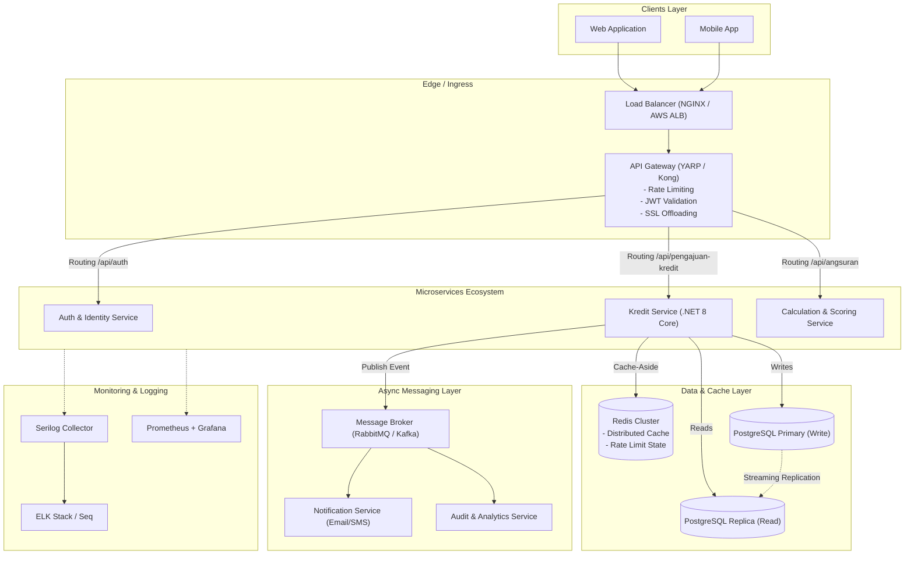

# Jawaban Soal 6 dan 7: Sistem Pengajuan Kredit

**Konteks:** Dokumen Jawaban Konseptual Take Home Test Senior Back-End Developer (PT Skyworx Indonesia)  
**Topik:** Soal 6 (Performance & Scalability) dan Soal 7 (System Design & Leadership)

---

## SOAL 6: Performance dan Scalability

### 6.1 Strategi Menangani Ribuan Pengguna per Hari
Sistem pengajuan kredit yang melayani ribuan pengguna harian memerlukan optimasi menyeluruh dari level aplikasi, ORM, hingga database engine:

1. **Database Indexing & Query Plan Optimization:**
   - Pembuatan B-Tree index pada kolom `plafon` dan `tenor` untuk mempercepat query filtering dan range scan.
   - Composite index `(tenor DESC, plafon DESC)` mengoptimalkan pencarian agregat eksekutif (misal: mencari pinjaman plafon terbesar dengan tenor terlama) sehingga query cukup melakukan *Index Scan* langsung tanpa *Sort operator* di memori.
2. **Efisiensi ORM (Entity Framework Core):**
   - Menggunakan `.AsNoTracking()` pada semua operasi baca (`GET`), meniadakan beban *change-tracking snapshot* di memori thread.
   - Menerapkan *Pagination* (`page` dan `pageSize`, maks 100) dengan `Skip()` dan `Take()` untuk membatasi konsumsi memori dan bandwidth payload.
3. **Asynchronous Non-Blocking I/O:**
   - Seluruh layer (Controller, Service, Repository, DbContext) menggunakan `async/await` end-to-end. Thread pool ASP.NET Core tidak terblokir selama I/O database berlangsung, menjaga throughput server tetap tinggi di bawah beban konkurensi.
4. **Database Connection Pooling:**
   - Memanfaatkan connection pooling bawaan driver `Npgsql` dengan tuning `MaxPoolSize` dan `ConnectionIdleLifetime` agar koneksi TCP ke PostgreSQL dapat dipakai ulang tanpa overhead *handshake* berulang.
5. **Horizontal Scaling & Stateless Architecture:**
   - Arsitektur backend bersifat *stateless* karena autentikasi berbasis JWT (JSON Web Token). Multiple instance API dapat berjalan di belakang Load Balancer tanpa membutuhkan shared session storage.

---

### 6.2 Strategi Caching dengan Redis
Penggunaan in-memory cache seperti Redis sangat relevan untuk sistem kredit, khususnya pada data read-heavy yang jarang berubah.

1. **Pola Cache-Aside (Lazy Loading):**
   - **Read Flow:** Aplikasi memeriksa Redis terlebih dahulu (`GET kredit:{id}`). Jika *cache hit*, data langsung dikembalikan. Jika *cache miss*, aplikasi mengambil data dari PostgreSQL, menyimpannya ke Redis, lalu mengembalikannya ke client.
   - **Key Convention:**
     - Detail Pengajuan: `kredit:detail:{id}` (TTL: 10 menit).
     - Daftar Terpaginasi: `kredit:list:page:{page}:size:{pageSize}` (TTL: 5 menit).
2. **Cache Invalidation:**
   - Saat terjadi mutasi (`POST /api/pengajuan-kredit`, `PUT`, atau `DELETE`), key `kredit:detail:{id}` dihapus secara eksplisit, dan cache daftar (`kredit:list:*`) diinvalidasi untuk mencegah inkonsistensi (*stale data*).
3. **Implementasi Teknis:**
   - Memanfaatkan abstraksi `IDistributedCache` di ASP.NET Core dengan package `Microsoft.Extensions.Caching.StackExchangeRedis`.

---

### 6.3 Dekomposisi ke Arsitektur Microservices
Jika skala bisnis berkembang pesat, monolitik backend dapat didekomposisi menjadi arsitektur microservices:

1. **Pemisahan Domain Service:**
   - **Auth Service:** Menangani manajemen user, kredensial, role, dan penerbitan token JWT.
   - **Kredit Service:** Mengelola entitas pengajuan kredit, CRUD, dan status persetujuan pinjaman.
   - **Kalkulasi & Scoring Service:** Service komputasi stateless khusus untuk kalkulasi anuitas, amortisasi, dan skor kelayakan kredit (credit scoring).
2. **Pola Komunikasi Antar-Service:**
   - **Sinkron (REST / gRPC):** Digunakan untuk komunikasi point-to-point yang membutuhkan response instan (misal: validasi token dari API Gateway atau kalkulasi angsuran cepat).
   - **Asinkron (Message Broker - RabbitMQ / Apache Kafka):** Menggunakan pola *Event-Driven Architecture*. Saat pengajuan kredit dibuat, Kredit Service menerbitkan event `PengajuanKreditCreatedEvent`. Service notifikasi (SMS/Email) dan audit log mengonsumsi event tersebut secara decoupling tanpa membebani thread utama.
3. **Database per Service:**
   - Masing-masing service memiliki database terisolasi untuk menjamin otonomi data dan mencegah tight-coupling skema.
4. **Observability & Resilience:**
   - Distributed tracing menggunakan **OpenTelemetry** dan Jaeger/Zipkin dengan menyematkan `Correlation-Id` di setiap hop request.

---

## SOAL 7: System Design dan Leadership

### 7.1 Arsitektur Enterprise

Berikut adalah rancangan arsitektur enterprise untuk sistem pengajuan kredit skala besar:

**Alur Interaksi:**
1. Request dari client diterima oleh **Load Balancer** yang mendistribusikan beban ke instance **API Gateway**.
2. **API Gateway** memverifikasi tanda tangan JWT, menerapkan rate limiting per-IP/user, lalu meneruskan request ke service terkait (*reverse proxy*).
3. **Kredit Service** membaca data dari **Redis** atau **PostgreSQL Read Replica** (untuk query baca), dan mengeksekusi insert/update langsung ke **PostgreSQL Primary**.
4. Setelah transaksi tersimpan di primary database, event asinkron dikirim ke **Message Broker** untuk diproses oleh service downstream (audit dan notifikasi).
5. Seluruh log terstruktur dialirkan via **Serilog** ke centralized logging (ELK / Seq), sementara metrik CPU, memory, latency dikumpulkan oleh **Prometheus** dan divisualisasikan di **Grafana**.

---

### 7.2 CI/CD dan Strategi Deployment Aman

1. **Pipeline CI/CD (GitHub Actions / GitLab CI / Azure DevOps):**
   - **Lint & Static Analysis:** Pemeriksaan format kode, SonarQube untuk deteksi *code smell* dan kerentanan keamanan.
   - **Build & Unit Test:** Eksekusi `dotnet test` otomatis; pipeline gagal jika ada test yang gagal atau coverage di bawah target minimum (misal: 80%).
   - **Containerization:** Pembuatan Docker image berbasis multi-stage build (distroless / alpine untuk meminimalkan attack surface).
   - **Artifact Versioning:** Image diberi tag semantic versioning dan commit SHA sebelum di-push ke Container Registry.
2. **Deployment ke Kubernetes (K8s):**
   - **Zero-Downtime Deployment:** Menggunakan strategi *Rolling Update* atau *Blue-Green Deployment*. Pod lama baru dihentikan setelah pod baru lulus health check.
   - **Health Probes:** Konfigurasi *Liveness Probe* (restart pod jika deadlock) dan *Readiness Probe* (hanya arahkan traffic jika service siap menerima request).
   - **Database Migration Terkontrol:** Menjalankan `dotnet ef migrations script` dalam job migrasi terpisah sebelum pod aplikasi baru aktif, dengan skema backwards-compatible (*Expand and Contract pattern*).
   - **Secret Management:** Kunci JWT dan connection string diinjeksi via Kubernetes Secrets atau secret vault (HashiCorp Vault / AWS Secrets Manager), tanpa pernah di-commit ke repository.
   - **Auto-Scaling:** Mengaktifkan *Horizontal Pod Autoscaler (HPA)* berdasarkan utilisasi CPU/Memory dan request count.

---

### 7.3 Leadership Teknis, Code Review, dan Mentoring

1. **Standar Code Review Tim:**
   - **Pull Request Berukuran Kecil:** Maksimal 300–400 baris kode per PR agar review mendalam dan fokus.
   - **Checklist Review:**
     - *Kebenaran Fungsional:* Apakah sesuai PRD dan kriteria penerimaan?
     - *Keamanan:* Validasi input (bebas injection), tidak ada hardcoded secret, otorisasi endpoint tepat.
     - *Performa:* Tidak ada potensi N+1 query, penggunaan `AsNoTracking()`, penghindaran boxing/alokasi memori berlebih.
     - *Testability:* Apakah PR menyertakan unit/integration test untuk skenario normal dan *edge cases*?
   - **Budaya Review Positif:** Mengedepankan komentar yang konstruktif dan solutif (menjelaskan alasan "mengapa", bukan sekadar perintah "ubah ini"), serta membedakan antara saran wajib dan opsional (*nitpick*).
2. **Strategi Mentoring Junior Developer:**
   - **Pair Programming:** Menjadwalkan sesi pair programming teratur untuk tugas-tugas arsitektur atau refactoring kunci.
   - **Pendelegasian Bertahap:** Memulai dari bug fixing dan penambahan unit test, meningkat ke implementasi endpoint baru, hingga perancangan skema database.
   - **1-on-1 Feedback:** Pertemuan rutin dua mingguan untuk mendiskusikan kendala teknis, target pembelajaran, dan pertumbuhan karier.

---

### 7.4 Pendekatan Problem Solving Senior Developer

1. **Menghadapi Lonjakan Traffic Ekstrem:**
   - Cek dashboard APM dan metrik (Grafana/Datadog): Identifikasi bottleneck apakah pada CPU aplikasi, thread pool starvation, memori, atau database connection pool exhaustion.
   - Terapkan tindakan darurat: Tingkatkan kapasitas instance (auto-scale HPA), perketat *Rate Limiting* untuk mencegah DoS, aktifkan *circuit breaker*, dan optimalkan cache hit ratio.
   - Lakukan post-mortem tanpa menyalahkan individu (*blameless post-mortem*) untuk mendokumentasikan akar masalah dan action item jangka panjang.
2. **Debugging Bug yang Hanya Terjadi di Production:**
   - Analisis *CorrelationId* pada centralized log (Seq/ELK) untuk merekonstruksi jejak eksekusi request spesifik yang gagal.
   - Periksa disparitas antara environment staging dan production (versi database, collation, timezone UTC, volume data, atau variabel konfigurasi).
   - Bila perlu, aktifkan logging level `Debug` secara selektif untuk komponen tertentu tanpa me-restart aplikasi.
   - Tulis *regression test* yang mereproduksi bug tersebut sebelum merilis *hotfix patch*.
3. **Mengelola Perubahan Requirement di Luar Scope (Scope Creep):**
   - Transparan dan proaktif berkomunikasi dengan Product Owner / Stakeholder bisnis.
   - Buat *Change Request (CR)* tertulis yang memetakan analisis dampak: pengaruh terhadap timeline pengiriman, estimasi waktu pengerjaan, risiko stabilitas arsitektur, dan kapasitas tim.
   - Tawarkan alternatif pragmatis: merilis fitur inti terlebih dahulu sesuai jadwal, dan menjadwalkan perubahan baru pada iterasi sprint berikutnya.
